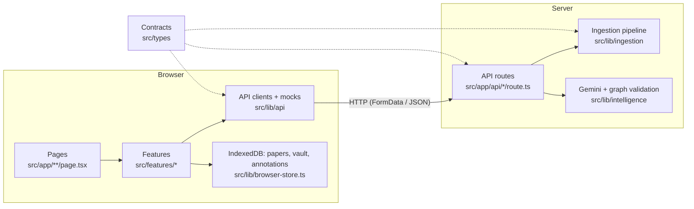

# Architecture

One Next.js application. The UI, the API routes, and the shared server-side logic live in the
same repo and deploy together.



## Layers

| Layer               | Location              | Runs in          | Responsibility                                                           |
| ------------------- | --------------------- | ---------------- | ------------------------------------------------------------------------ |
| Pages and layouts   | `src/app`             | Server or client | Composition and routing. Keep thin: arrange features and components.     |
| Components          | `src/components`      | Either           | Reusable, product-agnostic UI primitives. No data fetching.              |
| Features            | `src/features/<name>` | Mostly client    | A product capability's UI and state. Calls API clients.                  |
| API clients, mocks  | `src/lib/api`         | Browser-safe     | Typed `fetch` wrappers and mock payloads, one pair per endpoint.         |
| API routes          | `src/app/api`         | Server           | HTTP: parse the request, call shared logic, map errors to status.        |
| Shared server logic | `src/lib/<module>`    | Server only      | Ingestion, OCR providers, Gemini calls, and graph validation. Stateless. |
| Contracts           | `src/types`           | Both             | Types and constants shared across the network boundary.                  |

### The client/server boundary

- `src/lib/ingestion` starts with `import "server-only"`. Importing it from a Client Component
  fails the build. That is intentional.
- Frontend code talks to the server only through `src/lib/api/*-client.ts` and only imports
  types and constants from `src/types`.
- `src/types` must stay browser-safe: no Node APIs and no server imports.

## Ingestion pipeline

```
File / bytes → validateInput → PDF.js/text parser → quality gate → optional OCR → ParsedDocument
                (size, format)      (local first)       (consent)       (canonical)
```

**Public API** (`@/lib/ingestion`):

```ts
ingestFile(file: File): Promise<ParsedDocument>            // from FormData uploads
ingest({ fileName, mimeType, bytes }): Promise<ParsedDocument> // from any other source
IngestionError                                             // .code: IngestionErrorCode
```

Every expected failure throws `IngestionError` with a stable `code`. Anything else is a bug and
should surface as `INTERNAL_ERROR`.

**Using it from a new feature.** Do not write your own file reading or parsing. Either:

- **call the existing endpoint** from the browser with `uploadDocument(file)` from
  `@/lib/api/ingest-client`, or
- **call `ingest()` / `ingestFile()` server-side** from your own route or Server Component, then
  do your feature-specific work on the `ParsedDocument`:

```ts
// src/app/api/summarize/route.ts (hypothetical)
import { ingestFile } from "@/lib/ingestion";

const doc = await ingestFile(file);
const summary = await summarize(doc.sections); // feature logic works on the normalized result
```

### Extending ingestion

| Want to add…      | Do this                                                                                                                                                 |
| ----------------- | ------------------------------------------------------------------------------------------------------------------------------------------------------- |
| A new file format | Add an entry to `SUPPORTED_FORMATS` in `src/types/ingestion.ts`, then register a parser in `parsers.ts`. TypeScript fails until both exist. Add a test. |
| PDF / DOCX        | Same as above, using a parsing library chosen at that time. Parsers may be async.                                                                       |
| OCR               | Add a `DocumentParser` adapter under `src/lib/ingestion/ocr`; keep consent and normalization behavior.                                                  |
| AI extraction     | Extend `src/lib/intelligence`; never import the provider SDK from client code.                                                                          |
| Persistence       | Extend `src/lib/browser-store.ts`. Add server storage only if data must sync between browsers or devices.                                               |

PDF.js, Mistral OCR, Mathpix, Gemini intelligence, and browser IndexedDB storage are implemented.

## API contract

Every route returns the same envelope (`ApiResponse` in `src/types/api.ts`):

```jsonc
{ "ok": true,  "data": { /* endpoint-specific */ } }
{ "ok": false, "error": { "code": "STABLE_CODE", "message": "Human-readable." } }
```

Branch on `ok`, not on HTTP status. Status codes are still set correctly for tooling.

### `POST /api/ingest`

- **Request:** `multipart/form-data` with one field, `file`.
- **Accepts:** `.txt`, `.text`, `.md`, `.markdown`, and `.pdf` (by extension, falling back to MIME type). Maximum 25 MB.
- **Success (200):** `data` is a `ParsedDocument` (see `src/types/ingestion.ts`):

  | Field      | Meaning                                                                          |
  | ---------- | -------------------------------------------------------------------------------- |
  | `format`   | `"text"`, `"markdown"`, or `"pdf"`                                               |
  | `source`   | `{ fileName, mimeType, sizeBytes }` as uploaded                                  |
  | `title`    | First Markdown H1, else `null`                                                   |
  | `text`     | Full content, `\n` line endings, BOM removed                                     |
  | `pages`    | Page-preserving text, Markdown, equations, tables, and positions where available |
  | `sections` | Heading-aware content with original page references                              |
  | `metadata` | Canonical document metadata and page count                                       |
  | `stats`    | `{ characters, words, lines }`                                                   |
  | `warnings` | Non-fatal issues, e.g. an unclosed code fence                                    |
  | `parsedAt` | ISO timestamp                                                                    |

- **Errors:**

  | Status | `code`               | When                                   |
  | ------ | -------------------- | -------------------------------------- |
  | 400    | `INVALID_REQUEST`    | Body is not multipart form data        |
  | 400    | `NO_FILE`            | No `file` field                        |
  | 413    | `FILE_TOO_LARGE`     | Over 25 MB                             |
  | 415    | `UNSUPPORTED_FORMAT` | Not a supported extension or MIME type |
  | 422    | `EMPTY_FILE`         | Zero bytes or only whitespace          |
  | 422    | `DECODE_FAILED`      | Not valid UTF-8, or binary content     |
  | 422    | `PARSE_FAILED`       | A parser crashed unexpectedly          |
  | 500    | `INTERNAL_ERROR`     | Bug; logged server-side                |

  The client wrapper adds `NETWORK_ERROR` when the server can't be reached.

### Working against the contract before the backend exists

`src/lib/api/ingest-mock.ts` exports `MOCK_INGEST_SUCCESS` and `MOCK_INGEST_ERROR`. They are typed
against the real contract, and a unit test checks that the success mock matches what the real
pipeline produces. Label anything rendered from a mock as mock data so it is never mistaken for
real output.

### Adding a new endpoint

1. Define request/response types in `src/types/<domain>.ts` using `ApiResponse<Data, Codes>`.
2. Add a mock in `src/lib/api/<domain>-mock.ts` so frontend work can start immediately.
3. Implement the route in `src/app/api/<name>/route.ts`, keeping logic in `src/lib/<module>`.
4. Add a typed client in `src/lib/api/<domain>-client.ts`.
5. Document it in this file.

### PDF intelligence endpoints

| Endpoint                      | Contract and responsibility                                                                      |
| ----------------------------- | ------------------------------------------------------------------------------------------------ |
| `POST /api/documents/parse`   | Multipart `file`, `mode`, `ocrProvider`, and `allowExternalProcessing`; returns `{ document }`.  |
| `POST /api/documents/analyze` | JSON `{ document, mastery? }`; returns `{ analysis }`: validated graph and learning path.        |
| `POST /api/explain`           | JSON `{ document, concept, style, question? }`; explains using only the concept's source pages.  |
| `POST /api/quiz`              | JSON `{ concept }`; returns a bounded quiz including its answer key.                             |
| `POST /api/evaluate`          | JSON `{ quiz, answers }`; scores an explicit assessment. The only automatic mastery update path. |
| `GET /api/health`             | Reports service health and whether each provider is configured, never its credential.            |
| `POST /api/chat`              | JSON `{ messages, papers }` (`src/types/chat.ts`); returns `{ reply }` (Markdown, cites pages).  |

`/api/chat` is stateless like the rest: each request carries the whole conversation and the text
of the attached papers. The server keeps quoted pages first and trims the rest to a shared
character budget (`src/lib/intelligence/chat.ts`).

Provider calls are bounded by request cancellation/timeouts. Gemini receives section-aware excerpts, then Zod validates the response before the deterministic graph engine merges duplicates, drops invalid references, repairs cycles, topologically sorts, and calculates downstream impact.

### Cross-paper contradiction check

`POST /api/contradictions` accepts two to four distinct parsed documents and optional analyses.
It returns compared document IDs, candidate pair count, proposed conflicts with a verified quote
and page from each paper, independent Gemini/Grok verdicts, and warnings. Only Gemini-proposed
conflicts appear in the findings. The UI shows two-model agreement only when Grok also calls it a
contradiction; a missing or failed Grok review remains visible as needing review. Comparison is
bounded to 12 claims per paper and 24 candidate pairs. Long papers are sampled across their pages,
and the report warns when pages or page text are excerpted. The server stores no documents or
reports.

`src/lib/ai/gemini.ts` serves analysis, tutoring, and claim extraction. `src/lib/ai/grok.ts`
uses xAI's Responses API for independent review and reads `XAI_API_KEY` and `XAI_MODEL` only on
the server. Concept source quotes and contradiction claim quotes are checked against the cited
parsed page before they are shown as evidence.

### Paper recommendations (Track B)

`POST /api/recommendations` accepts `{ document: ParsedDocument, analysis: DocumentAnalysis,
limit?: number }` (default 8, maximum 20). The analysis must belong to the supplied document.
It returns `{ recommendations, queries, warnings }` inside the usual `ApiResponse` envelope;
see `src/types/research.ts` and `src/lib/api/research-mock.ts` for the contract and mock.

The server-only `src/lib/research` searches OpenAlex for up to three foundational concepts
and one related-work query. Only concept names, subject, and topics are sent to OpenAlex.
It excludes the current paper by title or metadata DOI, filters book reviews, deduplicates
IDs/DOIs/titles, and ranks by term overlap, citation count, recency, and open-access
availability. Bibliographic fields always come from OpenAlex; optional AI reasons are
currently `null`. No Gemini key is needed. Empty results succeed with a warning. Provider failures return
`SEARCH_PROVIDER_ERROR` (502), quotas return `SEARCH_RATE_LIMITED` (429), and a request
timeout returns `REQUEST_TIMEOUT` (504). Provider calls have a 12-second timeout and the
route has a 20-second deadline. `OPENALEX_API_KEY` is optional and server-only; anonymous
requests share an IP usage budget. No recommendation state is kept on the server.

The browser uses `src/lib/api/research-client.ts`. `RecommendationsPanel` searches on demand
and displays Read first / Related groups, provider links, missing abstracts, and the query trail.

### Voice endpoints

| Endpoint                | Contract and responsibility                                                                                       |
| ----------------------- | ----------------------------------------------------------------------------------------------------------------- |
| `GET /api/voice/voices` | Returns `{ configured, presets, account }`. Presets are confirmed against the ElevenLabs account at request time. |
| `POST /api/voice/speak` | JSON `SpeakRequest` (`text`, `voiceId`, `quality?`, `previousText?`, `nextText?`) → **streamed `audio/mpeg`**.    |

`/api/voice/speak` is the one route that does not return the JSON envelope on success; failures
still do (`VOICE_NOT_CONFIGURED`, `VOICE_NOT_FOUND`, `TEXT_TOO_LONG`, `VOICE_QUOTA_EXCEEDED`,
`VOICE_RATE_LIMITED`, `VOICE_PROVIDER_ERROR`). Use `speak()` from `src/lib/api/voice-client.ts`,
which returns `{ ok, audio }` or `{ ok, error }` either way.

Papers are prepared for listening in the browser by `buildReadingScript` (`src/lib/voice/reading-script.ts`):
running headers, page numbers, citations, URLs, the contents page, and the reference list are
removed; equations and code become a short notice pointing at their PDF page. The player
(`src/features/voice/use-speech-player.ts`) requests one segment at a time, prefetches the next
two, sends neighbouring text for smooth intonation, and caches audio in IndexedDB so replays are
free. Without an ElevenLabs key it falls back to the browser's built-in voice. Any feature can read
text aloud with `<ListenButton text={…} />`.

### Agent activity states (for the sprite)

`src/lib/agent-activity.ts` holds what the assistant is doing, for the animated sprite. API
clients report their own work through `track()`, so features get states without extra code:

| State             | Reported by                                   |
| ----------------- | --------------------------------------------- |
| `reading`         | `parseDocument` (PDF/text extraction)         |
| `analyzing`       | `analyzeDocument` (Gemini concept analysis)   |
| `searching`       | `requestRecommendations` (related papers)     |
| `comparing`       | `requestContradictions` (contradiction check) |
| `thinking`        | `requestExplanation`, `requestQuiz`           |
| `preparing-voice` | the speech player while audio is generated    |
| `speaking`        | the speech player while audio plays           |
| `error`           | any failed call, for 6 seconds                |
| `idle`            | nothing running (after a 400 ms grace period) |

When several things run at once, the highest-priority state shows (see `AGENT_STATES`).
React code uses `useAgentActivity()`; other code can listen for the `knowbefore:agent` window
event. `src/features/agent/AgentSprite.tsx` (in the extension panel) is the placeholder blob to
replace with the sprite: it maps `snapshot.state` to motion and color through `data-state`.
`AgentStatus.tsx` is the compact version in the vault's status bar. New features call
`track(state, detail, work)`.

### "Analyze this paper" pipeline

`runPaperPipeline` (`src/lib/paper-pipeline.ts`, browser) saves the paper and its original file,
runs Gemini analysis (reused if saved), then related papers and the contradiction check in
parallel. The check compares with up to three saved, analyzed papers whose topics overlap, and
is skipped when none do. Each step's status (`src/types/pipeline.ts`) and result is saved on the
paper's record, so the vault can read `recommendations`, `contradictions`, and `pipeline`
directly, and re-running resumes rather than repeating finished work.

### The research vault (`/`)

`src/features/vault` is the main UI: an Obsidian-style workspace with a file tree of folders,
notes, papers, and AI chats; tabs that can split into two panes; a PDF reader with highlights,
margin comments, and an "Ask AI" selection toolbar; and a right sidebar with the open paper's
analysis, related papers, contradiction check, read-aloud, and backlinks.

| Part                         | Where                                   |
| ---------------------------- | --------------------------------------- |
| Tree, notes, chats (types)   | `src/types/vault.ts`                    |
| Tree logic (pure, tested)    | `src/features/vault/vault-tree.ts`      |
| Tabs and split panes         | `src/features/vault/workspace-state.ts` |
| Vault data and imports       | `src/features/vault/use-vault.ts`       |
| PDF reader and annotations   | `src/features/vault/reader/*`           |
| Highlight and margin layout  | `src/features/vault/reader/geometry.ts` |
| Markdown (notes, AI replies) | `src/features/vault/Markdown.tsx`       |

The reader renders the stored PDF with PDF.js in the browser (canvas plus PDF.js's selectable text
layer); papers saved from web pages show their extracted text on fixed-width sheets instead.
Highlights are stored as rectangles in fractions of the unrotated page, so they stay in place at
any zoom or rotation. Papers saved by the extension are filed in the first project's
"Papers" folder (`defaultPaperFolder` in `vault-tree.ts`) and appear live. The extension's "Open in
vault" opens `/?paper=<document id>&page=<n>`, reusing an open vault tab; the reader also
remembers where you were in each paper (per browser). The original single-page
workspace (concept map, quizzes) remains at `/classic`.

### The extension panel (`/panel`)

`src/features/extension-panel` uses the same Obsidian theme (`src/components/theme`) and the
vault's `ChatView`. On a PDF tab it runs the analyze pipeline and sends the paper to the vault at a
page; elsewhere it is a chat whose conversations are filed in the vault's "Chats" folder. The
placeholder sprite is `src/features/agent/AgentSprite.tsx`.

Chrome's PDF viewer runs inside another extension's frame (in a closed shadow root), so neither
the scroll position nor the selection can be read by our extension. The page to open comes from the
URL's `#page=` or the page box in the panel.

### Storage: the browser owns state, the server is stateless

The server keeps nothing between requests. `src/lib/browser-store.ts` (IndexedDB) stores parsed
documents and their analyses keyed by the document's SHA-256 content hash, plus mastery records.
Clients send whatever a request needs (the document, a concept, a quiz) in the body. A restart loses
nothing, and re-uploading the same file reuses its stored analysis instead of calling Gemini again.

A paper's record also holds its pipeline results, and a `files` store keeps the original upload
(the PDF) for the vault. Voice adds two stores: generated audio (keyed by a hash of voice, quality, and text; the oldest
are evicted past 400 entries) and per-document reading positions.

The vault adds a `vault` store (folders, notes, paper placements, and chats with their messages)
and an `annotations` store (highlights and comments, indexed by document). Writes are announced on
a `BroadcastChannel`, so an open vault updates when the extension saves a paper.

IndexedDB is per origin. An extension side panel that loads a page from this app shares the web
app's storage; a page bundled inside the extension would have its own. Learning paths are derived
from the stored mastery profile and the validated graph.

## When to create what

- **New feature folder (`src/features/<name>`):** a distinct user-facing capability with its own
  UI and state. Start here by default.
- **New shared module (`src/lib/<name>`):** logic that a second feature needs, or that is clearly
  infrastructure (parsing, AI calls, storage). Do not pre-share speculatively; move code here when
  the second consumer appears.
- **New component (`src/components`):** a UI primitive used by two or more features, with no
  feature-specific knowledge.
- **New type file (`src/types`):** a contract that crosses the client/server boundary or is shared
  by multiple features. Feature-internal types stay in the feature folder.

## Why one application

For a small team on a weekend, one app gives us one dev server, one deploy, shared types without
publishing packages, and refactors that touch both sides in one PR. Next.js API routes are enough
for request/response work.

**Consider splitting a service out only if:**

- a job runs longer than a request should (big PDFs, batch AI processing) and needs a queue/worker;
- a dependency needs a different runtime (e.g. a Python ML library);
- a component needs to scale or deploy independently.

Even then, keep the contracts in `src/types` and move the module behind an HTTP client, so callers
don't change.
