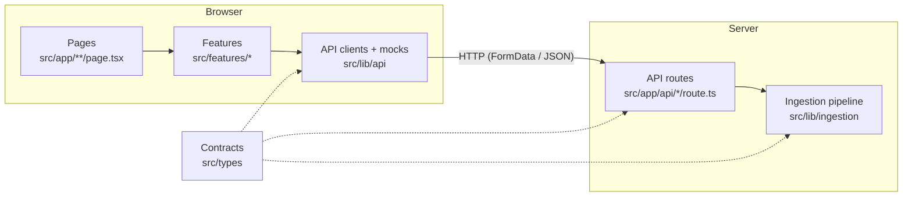

# Architecture

One Next.js application. The UI, the API routes, and the shared server-side logic live in the
same repo and deploy together.



## Layers

| Layer               | Location              | Runs in          | Responsibility                                                       |
| ------------------- | --------------------- | ---------------- | -------------------------------------------------------------------- |
| Pages and layouts   | `src/app`             | Server or client | Composition and routing. Keep thin: arrange features and components. |
| Components          | `src/components`      | Either           | Reusable, product-agnostic UI primitives. No data fetching.          |
| Features            | `src/features/<name>` | Mostly client    | A product capability's UI and state. Calls API clients.              |
| API clients, mocks  | `src/lib/api`         | Browser-safe     | Typed `fetch` wrappers and mock payloads, one pair per endpoint.     |
| API routes          | `src/app/api`         | Server           | HTTP: parse the request, call shared logic, map errors to status.    |
| Shared server logic | `src/lib/<module>`    | Server only      | The real work (ingestion now; AI extraction, storage later).         |
| Contracts           | `src/types`           | Both             | Types and constants shared across the network boundary.              |

### The client/server boundary

- `src/lib/ingestion` starts with `import "server-only"`. Importing it from a Client Component
  fails the build. That is intentional.
- Frontend code talks to the server only through `src/lib/api/*-client.ts` and only imports
  types and constants from `src/types`.
- `src/types` must stay browser-safe: no Node APIs and no server imports.

## Ingestion pipeline

```
File / bytes → validateInput → parsers[format] → ParsedDocument → consumer
                (size, format)   (decode, split)   (normalized)
```

**Public API** (`@/lib/ingestion`):

```ts
ingestFile(file: File): Promise<ParsedDocument>            // from FormData uploads
ingest({ fileName, mimeType, bytes }): Promise<ParsedDocument> // from any other source
IngestionError                                             // .code: IngestionErrorCode
```

Every expected failure throws `IngestionError` with a stable `code`. Anything else is a bug and
should surface as `INTERNAL_ERROR`.

**Using it from a new feature.** Do not write your own file reading or parsing. Either:

- **call the existing endpoint** from the browser with `uploadDocument(file)` from
  `@/lib/api/ingest-client`, or
- **call `ingest()` / `ingestFile()` server-side** from your own route or Server Component, then
  do your feature-specific work on the `ParsedDocument`:

```ts
// src/app/api/summarize/route.ts (hypothetical)
import { ingestFile } from "@/lib/ingestion";

const doc = await ingestFile(file);
const summary = await summarize(doc.sections); // feature logic works on the normalized result
```

### Extending ingestion

| Want to add…      | Do this                                                                                                                                                 |
| ----------------- | ------------------------------------------------------------------------------------------------------------------------------------------------------- |
| A new file format | Add an entry to `SUPPORTED_FORMATS` in `src/types/ingestion.ts`, then register a parser in `parsers.ts`. TypeScript fails until both exist. Add a test. |
| PDF / DOCX        | Same as above, using a parsing library chosen at that time. Parsers may be async.                                                                       |
| OCR               | A parser for image formats. Likely an external service; discuss first.                                                                                  |
| AI extraction     | A new module, `src/lib/extraction`, that takes a `ParsedDocument`. It does not go inside ingestion.                                                     |
| Persistence       | A new module, `src/lib/storage`. Ingestion stays storage-agnostic.                                                                                      |

None of these exist yet.

## API contract

Every route returns the same envelope (`ApiResponse` in `src/types/api.ts`):

```jsonc
{ "ok": true,  "data": { /* endpoint-specific */ } }
{ "ok": false, "error": { "code": "STABLE_CODE", "message": "Human-readable." } }
```

Branch on `ok`, not on HTTP status. Status codes are still set correctly for tooling.

### `POST /api/ingest`

- **Request:** `multipart/form-data` with one field, `file`.
- **Accepts:** `.txt`, `.text`, `.md`, `.markdown` (by extension, falling back to MIME type). UTF-8
  only. Maximum 5 MB.
- **Success (200):** `data` is a `ParsedDocument` (see `src/types/ingestion.ts`):

  | Field      | Meaning                                                                               |
  | ---------- | ------------------------------------------------------------------------------------- |
  | `format`   | `"text"` or `"markdown"`                                                              |
  | `source`   | `{ fileName, mimeType, sizeBytes }` as uploaded                                       |
  | `title`    | First Markdown H1, else `null`                                                        |
  | `text`     | Full content, `\n` line endings, BOM removed                                          |
  | `sections` | `{ heading, level, text }[]`, split on Markdown headings (one section for plain text) |
  | `stats`    | `{ characters, words, lines }`                                                        |
  | `warnings` | Non-fatal issues, e.g. an unclosed code fence                                         |
  | `parsedAt` | ISO timestamp                                                                         |

- **Errors:**

  | Status | `code`               | When                                   |
  | ------ | -------------------- | -------------------------------------- |
  | 400    | `INVALID_REQUEST`    | Body is not multipart form data        |
  | 400    | `NO_FILE`            | No `file` field                        |
  | 413    | `FILE_TOO_LARGE`     | Over 5 MB                              |
  | 415    | `UNSUPPORTED_FORMAT` | Not a supported extension or MIME type |
  | 422    | `EMPTY_FILE`         | Zero bytes or only whitespace          |
  | 422    | `DECODE_FAILED`      | Not valid UTF-8, or binary content     |
  | 422    | `PARSE_FAILED`       | A parser crashed unexpectedly          |
  | 500    | `INTERNAL_ERROR`     | Bug; logged server-side                |

  The client wrapper adds `NETWORK_ERROR` when the server can't be reached.

### Working against the contract before the backend exists

`src/lib/api/ingest-mock.ts` exports `MOCK_INGEST_SUCCESS` and `MOCK_INGEST_ERROR`. They are typed
against the real contract, and a unit test checks that the success mock matches what the real
pipeline produces. Label anything rendered from a mock as mock data so it is never mistaken for
real output.

### Adding a new endpoint

1. Define request/response types in `src/types/<domain>.ts` using `ApiResponse<Data, Codes>`.
2. Add a mock in `src/lib/api/<domain>-mock.ts` so frontend work can start immediately.
3. Implement the route in `src/app/api/<name>/route.ts`, keeping logic in `src/lib/<module>`.
4. Add a typed client in `src/lib/api/<domain>-client.ts`.
5. Document it in this file.

## When to create what

- **New feature folder (`src/features/<name>`):** a distinct user-facing capability with its own
  UI and state. Start here by default.
- **New shared module (`src/lib/<name>`):** logic that a second feature needs, or that is clearly
  infrastructure (parsing, AI calls, storage). Do not pre-share speculatively; move code here when
  the second consumer appears.
- **New component (`src/components`):** a UI primitive used by two or more features, with no
  feature-specific knowledge.
- **New type file (`src/types`):** a contract that crosses the client/server boundary or is shared
  by multiple features. Feature-internal types stay in the feature folder.

## Why one application

For a small team on a weekend, one app gives us one dev server, one deploy, shared types without
publishing packages, and refactors that touch both sides in one PR. Next.js API routes are enough
for request/response work.

**Consider splitting a service out only if:**

- a job runs longer than a request should (big PDFs, batch AI processing) and needs a queue/worker;
- a dependency needs a different runtime (e.g. a Python ML library);
- a component needs to scale or deploy independently.

Even then, keep the contracts in `src/types` and move the module behind an HTTP client, so callers
don't change.
